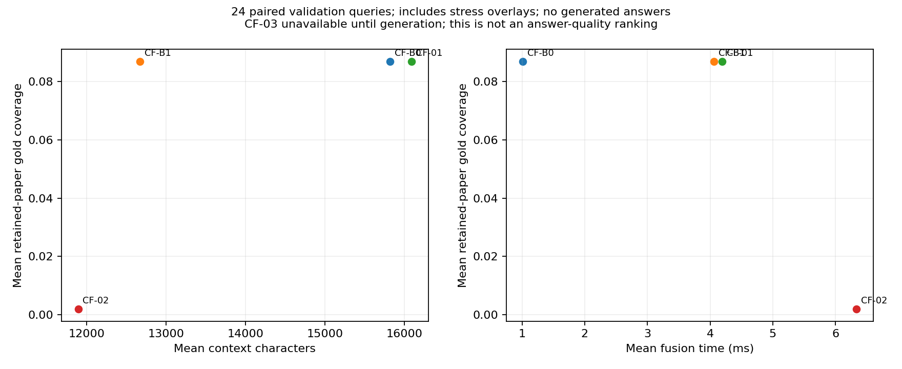

# Phase 8 Review Report — RQ2 Cross-Modal Fusion

## Latest review: completed paced v2 sample

Reviewed **11 October 2026 (Asia/Calcutta)**; v2 executed 10 October 2026. The explicitly approved `phase8-generation-v2-paced` run completed **16/16 requests and 10/10 final answers**, with **no provider errors, retries, malformed outputs, parser failures or truncation finish reasons**. Initial cooldown exceeded 90 seconds; every subsequent request start was at least 90 seconds apart. All scientific controls remained frozen.

**Measured usage: 47,277 input / 1,238 output tokens.** All five methods returned empty answers for both the normal and conflict query. Set accuracy, precision, recall, F1, Exact Match and answerability correctness are therefore zero for every final answer. These are completed negative results, not NULL/provider-failure substitutes.

The normal bundle lacks canonical evidence for gold paper 1258814; the conflict bundle adds only its conflicting-rank overlay. No explanation explicitly adjudicated that conflict. All six CF-03 intermediates abstained; its final allowed-ID union was empty. Correct conflict handling is not established. This remains a **bounded diagnostic generation sample**, not benchmark-wide evidence.

[Full v2 review and all intermediate/final answers](../phase8_generation_v2/Phase_08_V2_Review.md) · [Per-query metrics](../phase8_generation_v2/per_query_comparison.csv) · [Method comparison](../phase8_generation_v2/method_comparison.csv) · [Trade-offs](../phase8_generation_v2/tradeoffs.csv).

At tied zero answer quality, CF-03's smaller final context (mean 3,045.5 characters) required eight calls and 11,406 measured tokens across the pair, versus two calls and 7,401 tokens for CF-B1 (mean context 13,030 characters). Mean API generation latency was 2.887 seconds for CF-03 and 0.895 seconds for CF-B1. Total runner time includes deliberate pacing and is reported separately. These descriptive costs do not justify selecting an RQ2 winner.

Post-run checks: **30 relevant tests passed**, ten records' metrics recomputed, all 550 protected Phase 8 files and 695 raw/representation/benchmark payloads verified unchanged. [Preservation audit](../phase8_generation_v2/preservation.json). The original failed run and its journals remain completely unchanged. Its prior review text is retained below and as an exact [pre-v2 report snapshot](../phase8_generation_v2/Phase_08_Review_before_v2.md).

**STOP for human review. Phase 9 has not begun.**

## Historical offline and first-generation review

Date: 10 October 2026, Asia/Calcutta. Status: offline checks passed and the explicitly approved bounded diagnostic generation sample has been executed. Eleven requests produced two valid responses and nine rate-limit errors; no retries occurred. See the [generation review](../phase8/BOUNDED_GENERATION_REVIEW.md) for the complete updated results. Phase 9 has not begun.

## 1. Implementations

All five variants are implemented in additive `research/rq2` modules. See [exact protocol](../phase8/PROTOCOL.md) and [decision log](../phase8/DECISIONS.md).

| Method | Implemented behavior |
|---|---|
| CF-B0 | Raw source-order concatenation, atomic evidence, 24,000-character cap |
| CF-B1 | Explicit Text/Graph/Structured sections; 7,999 characters per section, including heading; separators charged globally |
| CF-01 | Exact canonical/STaRK ID, then unique normalized alias; primary entity groups, distinct source provenance; unresolved/ambiguous cases retained without fabricated labels |
| CF-02 | Fixed distinct-query-token overlap over frozen Graph/Structured payloads; at most five structural items, then ranked Text fills to ten; all choices logged |
| CF-03 | Three modality-specific intermediate calls, each capped at 220 completion tokens; strict parser; source-labeled late context; one final 1,024-token call |

CF-01 is a scoped KAG-inspired adaptation; it does not perform full concept extraction. CF-02 is a deterministic lexical adaptation rather than SAG's original learned selector/SQL system. CF-03 preserves the shared generation prompt/parser/model family, with no fine-tuning. No fusion method has retrieval/store access.

## 2. Evidence equality and preservation

Approved Phase 7 was checkpointed as `2600275b90c1943202004b69452f8f7dcf841aee`, with a clean working tree before implementation. The frozen MVP tag remains `4592d102b363c7d55d3c85ee67efe89409ae96b5`.

The [bundle manifest](../phase8/bundle_manifest.json) freezes 24 gold-free inputs from the approved B4 closeout records. Every source evidence field, score, provenance and within-source ordering is checked against those originals. B4 appended stress overlays after its mixed-source list; preparation partitions that list once into the contract's three source lists without changing each source's ranking. All five variants then receive byte-identical bundle inputs.

The [preservation audit](../phase8/preservation.json) passed for all 130 records (120 offline plus ten bounded diagnostic records) and recomputed their metrics. It verified 338 Phase 7 review files, all prior tracked files, 54 frozen baseline files, four original storage files and 695 immutable raw/representation/benchmark payloads totaling 7,165,516,177 bytes. The 13,404 official unverified annotations remain unverified. Reading protected test files for checksums/schema auditing is not test experiment execution.

## 3. Configurations and reproducibility

Five named configs are under `configs/rq2/*-context_only.json`. Common cap: 24,000 characters. Seed: 42 with unchanged per-query seed derivation. Model, when authorized: `openai/gpt-oss-120b`, temperature 0, reasoning effort low; final cap 1,024, intermediate cap 220. Retrieval parameters remain recorded from approved B4 provenance. No retrieval tuning, source budget tuning, or Phase 7 modification occurred.

Inputs, options, model settings, prompt, source code, benchmark and representation identity participate in fingerprints. The unchanged Phase 5 runner rejects incompatible existing runs. A second real execution resumed all 120 records without changing any record byte: [resume audit](../phase8/resume_audit.json).

## 4. Tests

**185 tests passed**, including 24 new RQ2 tests. The one warning is the pre-existing DuckDB `fetch_record_batch()` deprecation. [JUnit artifact](../phase8/tests.xml).

Tests cover deterministic input preservation, modality boundaries, source budgets, atomic oversize omission, NULL payloads, ID/alias precedence and ambiguity, Unicode normalization, selector bounds/ties/zero-overlap, complete decision logging, overlay provenance, offline CF-03 NULLs, true four-stage generation through fake generators, usage capture on parser failure, durable stage replay, ambiguous-dispatch refusal, Phase 5 schema/identity/resume/config rejection, question/overlay mismatch, forbidden retrieval dependencies and the read-only Streamlit viewer. An initial restricted-sandbox run could not create pytest temporary directories; the complete authorized host run passed. No test invokes a paid API.

## 5. Validation results and cohorts

24 paired questions × five methods = **120 context-only records**, zero execution errors.

| Dimension | Counts per method |
|---|---|
| Modality | TG 6; TS 6; GS 6; TGS 6 |
| Reasoning | Single-hop 6; multi-hop-2 18 |
| Stress | Normal 8; noisy 8; conflict 8 |

No official synthetic, test or human-test records were executed. No 3+ hop claim is made. All benchmark annotations used here are programmatically verified, with human review still pending.

Machine-generated [standard cohorts](../phase8/context_only_cohorts.csv), [fusion cohorts](../phase8/context_only_fusion_cohorts.csv), [per-query measurements](../phase8/context_only_per_query.csv) and [summary](../phase8/context_only_summary.csv) include explicit `NULL` and availability counts. Unavailable answer F1/accuracy, context tokens, measured API tokens, cost, independent entity-alignment accuracy and conflict-handling accuracy remain NULL.

## 6. Approved bounded diagnostic generation sample

The frozen two-query plan was explicitly approved and executed once. **11 of at most 16 requests were made: two valid responses and nine Groq `RateLimitError` failures.** No retries, repairs, changed caps/prompts or query substitutions occurred. CF-03 stopped on intermediate failures and did not reach either final call.

CF-B0 conflict returned an empty set against gold `{1258814}`: set accuracy, Exact Match, precision, recall, F1 and answerability correctness are all zero. All other final-answer metrics remain NULL. Known usage is 6,970 input and 154 output tokens; failed-request usage is unknown. The sole completed final answer took 1,411.0393 ms generation / 1,420.2797 ms total. CF-03 conflict produced one valid empty Text intermediate (54 output tokens), then its Graph request failed. No malformed received outputs or parser failures were observed; provider finish reasons were not retained.

The [bounded generation review](../phase8/BOUNDED_GENERATION_REVIEW.md) reports per-method calls, normal/conflict behavior, partial usage, intermediate outputs, provider failures, and interpretive limits. [Per-query diagnostic table](../phase8/bounded_generation_diagnostics.csv). No completed normal final answer exists, so a paired effect or meaningful comparative answer-quality frontier cannot be established. This is a bounded diagnostic generation sample, not benchmark-wide evidence. No winner is selected.

## 7. Context and fusion efficiency

Means across the same 24 questions; coverage is retained-paper intersection with benchmark gold, not answer quality.

| Method | Context chars | Fusion ms | Gold coverage | Gold coverage excluding overlays |
|---|---:|---:|---:|---:|
| CF-B0 | 15,818.7 | 1.016 | 0.086855 | 0.002000 |
| CF-B1 | 12,672.0 | 4.061 | 0.086855 | 0.002000 |
| CF-01 | 16,093.8 | 4.189 | 0.086855 | 0.002000 |
| CF-02 | 11,895.1 | 6.335 | 0.002000 | 0.002000 |
| CF-03 | NULL | 4.600 preparation only | NULL | NULL |

CF-03 prepared intermediate inputs average 12,672.0 characters. This is not its final fused context or completed latency. Source preparation coverage averages 0.946701. For the early variants, mean source coverage is CF-B0 0.960069, CF-B1 0.946701, CF-01 0.957292, CF-02 0.713542. Absent-source denominators are NULL, not zero. Within-source entity redundancy was zero where defined. These are deterministic ID-based measures, not semantic redundancy estimates.



## 8. Alignment and selector diagnostics

CF-01 processed **372 evidence assignments**, all resolved by exact IDs, with zero unresolved assignments. Only **one cross-source group across 24 inputs** exists, so this sample barely exercises the purported benefit of entity alignment. Exact alias ambiguity/fallback is tested synthetically, not claimed as a measured real-data success. Independent entity-alignment correctness remains NULL.

CF-02 selected five Graph items and five Text items for every query; no Structured candidate survived the fixed structural selector. All scores, overlaps, source ranks, decisions and retention outcomes are recorded. This is an observed failure to retain structured evidence under the frozen lexical selector; no quota or weight was tuned afterward.

## 9. Conflict analysis

Across eight conflict inputs, CF-B0, CF-B1 and CF-01 each retained six tagged overlay items; CF-02 retained none. Original NULLs and conflicting payloads are preserved separately. The shared generator prompt instructs preference for immutable canonical evidence. The bounded sample yielded one conflict answer but cannot establish correct conflict resolution; see the generation review.

The first three methods' mean conflict-stratum gold coverage is 0.256565, versus 0.002 for CF-02. This apparent gain is dominated by overlay paper IDs and must not be presented as correct reasoning. Without overlays, all four early variants average only 0.002 coverage overall. Dropping every conflict item does not establish correct conflict handling. The corresponding accuracy metric remains NULL.

## 10. Pareto results

The [machine-generated Pareto table](../phase8/context_only_pareto.csv) treats quality as maximized and cost as minimized, with no automatic winner.

* Retained-paper gold coverage versus context characters: CF-B1 and CF-02 are descriptive nondominated candidates.
* Retained-paper gold coverage versus fusion time: CF-B0 is nondominated.
* Mean source coverage versus context characters: CF-B0, CF-B1 and CF-02 are nondominated.
* Answer quality versus context/latency/calls/tokens and conflict accuracy comparisons are **unavailable**, not ties or zero scores.

These findings are conditional on sparse upstream gold coverage and stress-overlay confounding. Sub-millisecond differences and one-run latency estimates are not statistically significant performance claims.

## 11. Representative outcomes

[Machine-selected cases](../phase8/context_only_representative_cases.json) retain IDs and query references.

* `generated:92af2a9e24dd0b4edcdc:conflict`: CF-B0/B1/01 obtain nominal retained-paper coverage 1.0, including structured overlay `structured:paper:1634111:overlay`. This is a useful example of why paper intersection is not answer correctness.
* `generated:69a22c3b4989b07ed6c3:noisy`: all three early concatenation/alignment variants obtain zero retained-paper coverage. Fusion cannot repair missing upstream evidence without violating the fixed-retrieval experiment.
* `generated:824083f22c1dad1b1c02:normal`: CF-02's highest retained-paper coverage is only 0.016. It is a positive intersection example, not a successful generated answer.
* CF-01's exact-ID and immutable-provenance checks pass; CF-03's four-call/source isolation and crash behavior pass deterministic fixtures. These engineering successes are kept separate from scientific answer outcomes.

## 12. Resources and API usage

Preparation: 32.97 seconds, peak working set 138,899,456 bytes (132.5 MiB). The five offline runner invocations totaled approximately 13.23 seconds, peak process working set 79,687,680 bytes (76.0 MiB). Per-query measured total latency averaged 2.52–12.13 ms. Full preservation auditing took 53.56 seconds. These measurements include local system noise and do not characterize live generation throughput.

**Offline study:** zero new retrieval calls, zero live LLM calls and zero model downloads. **Subsequent approved diagnostic sample:** 11 API requests, two measured responses, nine rate-limit errors; known usage 6,970 input / 154 output tokens. Failed-call usage remains NULL. Disk had approximately 300.6 GiB free at the preservation audit. Full graph loading is not used.

## 13. Limitations

The small validation sample is not a paper-quality evaluation. Low canonical upstream coverage, minimal cross-source entity overlap and overlay-related gold intersections constrain interpretation. Exact-ID redundancy does not measure semantic redundancy. Primary-entity alignment does not implement full concept resolution. Lexical selection can favor graph labels and discard relevant structured comparisons. No learned selector, advanced context pruning or agent is implemented. CF-03's final live reasoning, overall truncation rate, cost and conflict behavior remain unmeasured because intermediate rate-limit failures prevented final fusion. Remote determinism is not guaranteed by a fixed seed.

## 14. Candidates for human review and viewer

CF-B1 is a compact coverage-preserving candidate; CF-B0 offers the lowest measured local fusion latency; CF-02 is a compactness/quality trade-off with a serious Structured-retention failure. CF-01 and CF-03 need more evidence to support scientific advantage. None is selected as a winner.

The separate read-only viewer is `fusion_review_app.py`, launched with:

```powershell
.\.venv\Scripts\python.exe -m streamlit run fusion_review_app.py --server.port 8504
```

It shows exact incoming bundles, provenance, contexts, entity groups, selector decisions, prepared source inputs, stage responses when present and measured metrics. It has no generation/retrieval controls. Existing Phase 0 and earlier viewer code remains unchanged.

Reproduce offline preparation/execution/report/audit with:

```powershell
.\.venv\Scripts\python.exe scripts/prepare_phase8.py
.\.venv\Scripts\python.exe scripts/run_phase8.py
.\.venv\Scripts\python.exe scripts/report_phase8.py
.\.venv\Scripts\python.exe scripts/audit_phase8.py
```

Existing incompatible artifacts are refused. Do not enable `--approved-generation-plan` without explicit approval of the prepared sample.

## 15. Phase 9 readiness and stop gate

The fusion interface, immutable inputs, deterministic experiments, durable stage journal, metrics, comparisons, tests and preservation checks are ready for review. The approved bounded diagnostic sample has finished with nine rate-limit failures and only one final answer. Its results are recorded in the linked generation review; they do not support comparative answer-quality claims or a scientific fusion-method choice. No additional calls are authorized by this completion, and none are scheduled. **Phase 9 has not begun and requires separate approval.**
