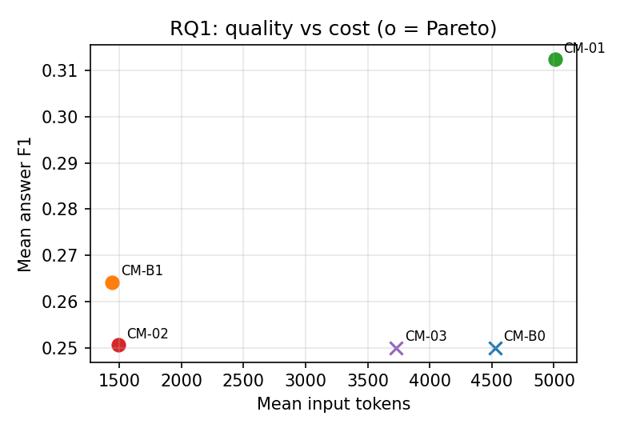

# Results package (validation results; locked test out of scope)

Generated by `scripts/build_results_package.py` from the frozen analyses. ★ = Pareto set. Statistics: family-clustered bootstrap CI, exact sign-flip test over base families, Holm correction; * = Holm p < 0.05.

## RQ1
| Method | Answer F1 | EM | MRR | Gold coverage | Input tokens | Latency ms |
|---|---|---|---|---|---|---|
| CM-B0 | 0.250 | 0.250 | 0.295 | 0.225 | 4,526 | 1,171 |
| CM-B1 ★ | 0.264 | 0.250 | 0.353 | 0.221 | 1,443 | 1,093 |
| CM-01 ★ | 0.312 | 0.250 | 0.359 | 0.175 | 5,009 | 5,116 |
| CM-02 ★ | 0.251 | 0.250 | 0.187 | 0.085 | 1,491 | 1,058 |
| CM-03 | 0.250 | 0.250 | 0.171 | 0.298 | 3,731 | 32,435 |

| Pair | Δ answer F1 | 95 % CI | p (sign-flip) | p (Holm) |
|---|---|---|---|---|
| CM-B0 vs CM-B1 | -0.014 | [-0.037, 0.000] | 0.500 | 1.000 |
| CM-B0 vs CM-01 | -0.062 | [-0.174, 0.000] | 0.500 | 1.000 |
| CM-B0 vs CM-02 | -0.001 | [-0.002, 0.000] | 1.000 | 1.000 |
| CM-B0 vs CM-03 | 0.000 | [0.000, 0.000] | 1.000 | 1.000 |
| CM-B1 vs CM-01 | -0.048 | [-0.137, 0.000] | 0.500 | 1.000 |
| CM-B1 vs CM-02 | 0.014 | [0.000, 0.036] | 0.500 | 1.000 |
| CM-B1 vs CM-03 | 0.014 | [0.000, 0.037] | 0.500 | 1.000 |
| CM-01 vs CM-02 | 0.062 | [0.000, 0.173] | 0.500 | 1.000 |
| CM-01 vs CM-03 | 0.062 | [0.000, 0.174] | 0.500 | 1.000 |
| CM-02 vs CM-03 | 0.001 | [0.000, 0.002] | 1.000 | 1.000 |

## RQ2
Pending (analysis not yet available).

## RQ3
Pending (analysis not yet available).

## RQ4
Pending (analysis not yet available).

