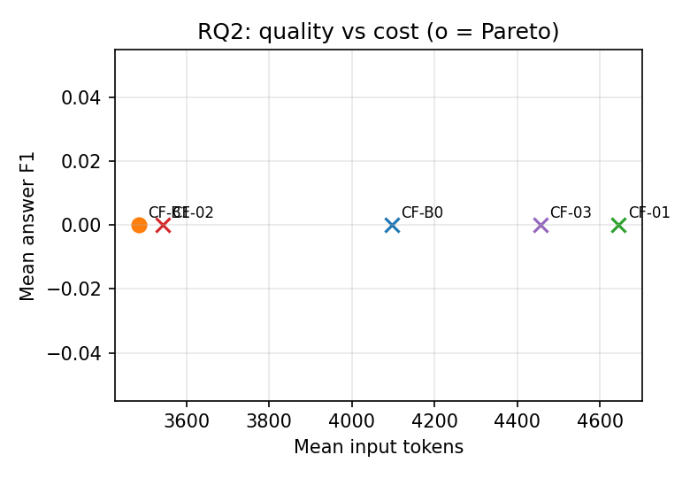
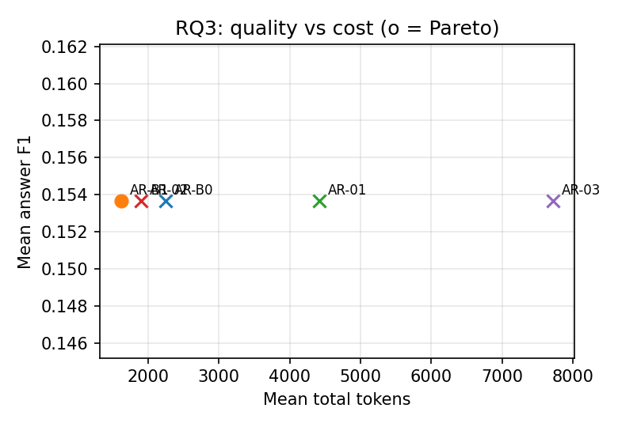
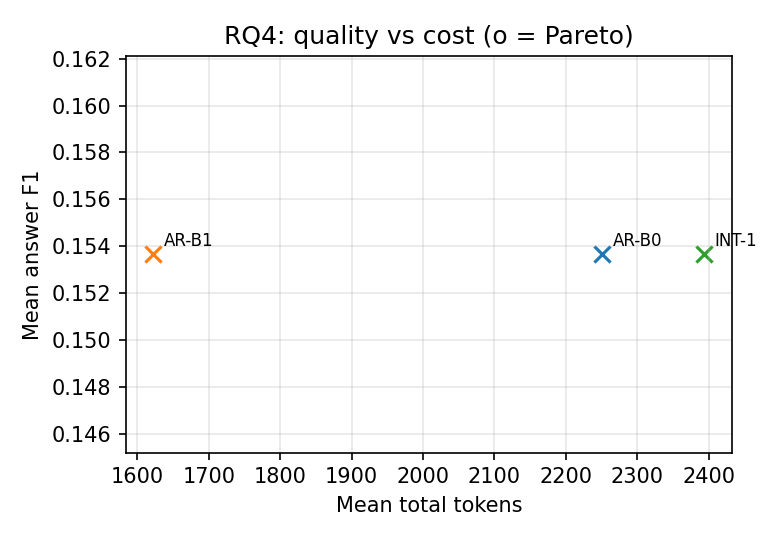

# Results package (validation results; locked test out of scope)

Generated by `scripts/build_results_package.py` from the frozen analyses. ★ = Pareto set. Statistics: family-clustered bootstrap CI, exact sign-flip test over base families, Holm correction; * = Holm p < 0.05.

## RQ1
| Method | Answer F1 | EM | MRR | Gold coverage | Input tokens | Latency ms |
|---|---|---|---|---|---|---|
| CM-B0 | 0.250 | 0.250 | 0.295 | 0.225 | 4,499 | 9,865 |
| CM-B1 ★ | 0.264 | 0.250 | 0.353 | 0.221 | 1,416 | 7,645 |
| CM-01 ★ | 0.283 | 0.250 | 0.359 | 0.175 | 4,982 | 17,795 |
| CM-02 ★ | 0.251 | 0.250 | 0.187 | 0.085 | 1,464 | 6,503 |
| CM-03 | 0.250 | 0.250 | 0.292 | 0.338 | 3,658 | 40,709 |

| Pair | Δ answer F1 | 95 % CI | p (sign-flip) | p (Holm) |
|---|---|---|---|---|
| CM-B0 vs CM-B1 | -0.014 | [-0.037, 0.000] | 0.500 | 1.000 |
| CM-B0 vs CM-01 | -0.033 | [-0.090, 0.000] | 0.500 | 1.000 |
| CM-B0 vs CM-02 | -0.001 | [-0.002, 0.000] | 1.000 | 1.000 |
| CM-B0 vs CM-03 | 0.000 | [0.000, 0.000] | 1.000 | 1.000 |
| CM-B1 vs CM-01 | -0.019 | [-0.054, 0.000] | 0.500 | 1.000 |
| CM-B1 vs CM-02 | 0.014 | [0.000, 0.036] | 0.500 | 1.000 |
| CM-B1 vs CM-03 | 0.014 | [0.000, 0.037] | 0.500 | 1.000 |
| CM-01 vs CM-02 | 0.033 | [0.000, 0.090] | 0.500 | 1.000 |
| CM-01 vs CM-03 | 0.033 | [0.000, 0.090] | 0.500 | 1.000 |
| CM-02 vs CM-03 | 0.001 | [0.000, 0.002] | 1.000 | 1.000 |

## RQ2
| Method | Answer F1 | EM | MRR | LLM calls | Input tokens | Latency ms |
|---|---|---|---|---|---|---|
| CF-B0 | 0.000 | 0.000 | 0.029 | 1.000 | 4,097 | 11,023 |
| CF-B1 ★ | 0.000 | 0.000 | 0.029 | 1.000 | 3,485 | 8,389 |
| CF-01 | 0.000 | 0.000 | 0.029 | 1.000 | 4,644 | 9,123 |
| CF-02 | 0.000 | 0.000 | 0.000 | 2.000 | 3,542 | 12,610 |
| CF-03 | 0.000 | 0.000 | 0.062 | 3.750 | 4,455 | 19,609 |

| Pair | Δ answer F1 | 95 % CI | p (sign-flip) | p (Holm) |
|---|---|---|---|---|
| CF-01 vs CF-B0 | 0.000 | [0.000, 0.000] | 1.000 | 1.000 |
| CF-01 vs CF-B1 | 0.000 | [0.000, 0.000] | 1.000 | 1.000 |
| CF-02 vs CF-B0 | 0.000 | [0.000, 0.000] | 1.000 | 1.000 |
| CF-02 vs CF-B1 | 0.000 | [0.000, 0.000] | 1.000 | 1.000 |
| CF-03 vs CF-B0 | 0.000 | [0.000, 0.000] | 1.000 | 1.000 |
| CF-03 vs CF-B1 | 0.000 | [0.000, 0.000] | 1.000 | 1.000 |
| CF-B1 vs CF-B0 | 0.000 | [0.000, 0.000] | 1.000 | 1.000 |

## RQ3
| Method | Answer F1 | EM | Source F1 | Wasted retrieval | Stopping acc. | Retrieval calls | Tokens | Latency ms |
|---|---|---|---|---|---|---|---|---|
| AR-B0 | 0.154 | 0.143 | 0.700 | 0.429 | 0.571 | 3.000 | 2,251 | 10,623 |
| AR-B1 ★ | 0.154 | 0.143 | 0.876 | 0.190 | 0.571 | 2.143 | 1,622 | 8,726 |
| AR-01 | 0.154 | 0.143 | 0.843 | 0.238 | 0.571 | 2.429 | 4,419 | 24,061 |
| AR-02 | 0.154 | 0.143 | 0.807 | 0.286 | 0.571 | 2.571 | 1,906 | 10,564 |
| AR-03 | 0.154 | 0.143 | 0.871 | 0.012 | 0.500 | 1.857 | 7,719 | 45,228 |

| Pair | Δ answer F1 | 95 % CI | p (sign-flip) | p (Holm) |
|---|---|---|---|---|
| AR-01 vs AR-B0 | 0.000 | [0.000, 0.000] | 1.000 | 1.000 |
| AR-01 vs AR-B1 | 0.000 | [0.000, 0.000] | 1.000 | 1.000 |
| AR-02 vs AR-B0 | 0.000 | [0.000, 0.000] | 1.000 | 1.000 |
| AR-02 vs AR-B1 | 0.000 | [0.000, 0.000] | 1.000 | 1.000 |
| AR-03 vs AR-B0 | 0.000 | [0.000, 0.000] | 1.000 | 1.000 |
| AR-03 vs AR-B1 | 0.000 | [0.000, 0.000] | 1.000 | 1.000 |
| AR-B1 vs AR-B0 | 0.000 | [0.000, 0.000] | 1.000 | 1.000 |

## RQ4
| Method | Answer F1 | EM | Source F1 | Tokens | Latency ms |
|---|---|---|---|---|---|
| AR-B0 | 0.154 | 0.143 | 0.700 | 2,251 | 10,623 |
| AR-B1 | 0.154 | 0.143 | 0.876 | 1,622 | 8,726 |
| INT-1 | 0.154 | 0.143 | 0.876 | 2,394 | 9,916 |

| Pair | Δ answer F1 | 95 % CI | p (sign-flip) | p (Holm) |
|---|---|---|---|---|
| INT-1 vs AR-B0 | 0.000 | [0.000, 0.000] | 1.000 | 1.000 |
| INT-1 vs AR-B1 | 0.000 | [0.000, 0.000] | 1.000 | 1.000 |

Selection: {"CM": "CM-B1", "R-AR": "AR-B1", "R-CF": "CF-B1", "rq2_analysis_sha256": "ddb2cf48810fa4226690fef1781a45a5a5c7a604b80a0c0819c1cc8b9e909b91", "rq3_analysis_sha256": "58f3b71bf1ea6a7a85a40394b5aef39a5df89540646efcdc2b01c4938ce48c8f", "rules": "documentation/rq4/RQ4_DESIGN.md (R-AR, R-CF), applied mechanically"}

## Overall ranking (one winner per part)

Rank 1-5 on each frozen Pareto axis of the part (equal weight, average ranks for ties); lowest total wins; ties: higher answer F1, fewer tokens, then B1, 01, 02, 03, B0. Check: mean of min-max scaled axis scores.

**RQ1 — winner: CM-B1** (scaled-score check: CM-B1; quality-first rule: CM-01)

| Method | rank: answer_f1 | rank: mrr | rank: input_tokens | rank: latency | Rank total | Scaled score |
|---|---|---|---|---|---|---|
| CM-B1 | 2 | 2 | 1 | 2 | 7 | 0.838 |
| CM-01 | 1 | 1 | 5 | 4 | 11 | 0.667 |
| CM-02 | 3 | 5 | 2 | 1 | 11 | 0.501 |
| CM-B0 | 4.5 | 3 | 4 | 3 | 14.5 | 0.417 |
| CM-03 | 4.5 | 4 | 3 | 5 | 16.5 | 0.246 |

**RQ2 — winner: CF-B1** (scaled-score check: CF-B1; quality-first rule: CF-B1)

| Method | rank: answer_f1 | rank: input_tokens | rank: latency | Rank total | Scaled score |
|---|---|---|---|---|---|
| CF-B1 | 3 | 1 | 1 | 5 | 1.000 |
| CF-02 | 3 | 2 | 4 | 9 | 0.858 |
| CF-B0 | 3 | 3 | 3 | 9 | 0.746 |
| CF-01 | 3 | 5 | 2 | 10 | 0.645 |
| CF-03 | 3 | 4 | 5 | 12 | 0.388 |

**RQ3 — winner: AR-B1** (scaled-score check: AR-B1; quality-first rule: AR-B1)

| Method | rank: answer_f1 | rank: source_f1 | rank: total_tokens | rank: latency | Rank total | Scaled score |
|---|---|---|---|---|---|---|
| AR-B1 | 3 | 1 | 1 | 1 | 6 | 1.000 |
| AR-02 | 3 | 4 | 2 | 2 | 11 | 0.878 |
| AR-B0 | 3 | 5 | 3 | 3 | 14 | 0.711 |
| AR-01 | 3 | 3 | 4 | 4 | 14 | 0.733 |
| AR-03 | 3 | 2 | 5 | 5 | 15 | 0.493 |

Combined (RQ4): winners {'RQ1': 'CM-B1', 'RQ2': 'CF-B1', 'RQ3': 'AR-B1'}; INT-1 pipeline AR-B1 -> CM-B1 -> CF-B1; identical: True

